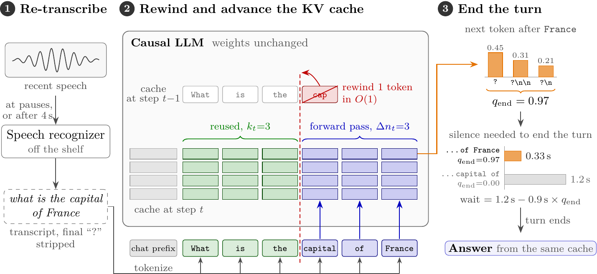

# Rewind-Listen

[](https://github.com/22cav/rewind-listen/actions/workflows/ci.yml)
[](LICENSE)




**Streaming a spoken question into an unmodified LLM through a rewindable KV cache.**

Rewind-Listen lets an unmodified on-device LLM read a spoken question while it is being spoken. At each pause (or
after 4 s of speech without one), a speech recognizer transcribes the recent audio, and the transcript goes straight
into the LLM's key-value cache. When the recognizer revises its last words, the cache is rewound to the longest token
prefix the two transcripts share, and only the changed tail is read again. So when the speaker stops, the LLM has
already read the question and starts answering almost at once. Its own next-token probabilities, together with the
silence that follows, tell when the question is finished.

Nothing is trained: a parakeet-mlx recognizer and any mlx-lm chat model, on an Apple Silicon Mac.

## Try it (Mac with Apple Silicon, macOS 14 or later)

```bash
git clone https://github.com/22cav/rewind-listen && cd rewind-listen
./run.sh setup                                 # environment + models (once)
./run.sh talk                                  # speak; it answers when you have finished
./run.sh ask samples/question.wav              # answer a spoken question in a recording
./run.sh transcribe my_memo.m4a                # write down what is said
```

Any mlx-lm chat model works unchanged: `./run.sh talk --llm mlx-community/Llama-3.2-3B-Instruct-4bit`.

From Python:

```python
from listen.stream import Listener
lis = Listener()                       # Parakeet 110M + Qwen3-1.7B (4-bit)
lis.start()
for frame in frames:                   # 20 ms of 16 kHz audio at a time
    if lis.feed(frame):                # True once the turn has ended
        break
print("".join(lis.finish()))
```

## How it works

At each pause (and after 4 s of speech without one) the recognizer transcribes the current audio window. The
transcript is tokenized, the LLM's KV cache is rewound to the longest prefix it shares with the cached tokens, and
only the new tail is read. Causal attention makes the cache equal to reading the whole transcript from scratch. After
each read, q_end, the probability that the next character closes the sentence, sets how much trailing silence
(measured on the waveform) ends the turn: about 1.2 s mid-sentence, down to 0.3 s after a finished question. The whole
mechanism is `listen/stream.py`.

## Results

On an 8 GB MacBook Air M2 with Qwen3-1.7B (4-bit):

- **Speed:** the first answer token comes 125 ms after the end of the turn, against 493 ms for the same recognizer and
  LLM run one after the other. The LLM reads 1.6x the transcript length (6.8x without rewinds).
- **Accuracy:** on 1,064 VoiceBench multiple-choice questions it matches the offline cascade (39.9 % vs 39.2 %); the
  gap to the written question (45.9 %) comes mostly from how speech is written down, not from recognition errors.
- **Turn ending:** the LLM's own completion probability gives a 38 % shorter wait than a fixed silence timeout at the
  same rate of cut-offs.
- **Other models:** Qwen3-4B and Llama-3.2-3B run with only the model name changed.

## Layout

| path | contents |
|---|---|
| `listen/` | the library: `stream.py` (the mechanism), `llm.py`, `audio.py`, `mcq.py` (VoiceBench's answer extraction), `splits.py`, `cli.py` |
| `bench/` | the experiments: `reproduce.sh` (every experiment and table), `run.py` (the runner), `cascade.py` (offline baselines), `analyze.py` (the tables), `vb_score.py` (BBH, IFEval), `checks.py` (two checks in the text), `prompts.py` (spoken-form prompts), `data.py` (evaluation sets) |
| `tests/` | `pytest -q`: no network needed |
| `samples/` | `question.wav`, a spoken VoiceBench question (Apache-2.0) |

## Reproduce

`bench/reproduce.sh` downloads the public evaluation data, runs every experiment and prints every results table
(several hours; the timed runs need an idle Mac on power). Its header lists the optional inputs: LibriTTS-R for the
WER clips, an mlx-whisper environment for the Whisper baseline, and a VoiceBench clone for the BBH and IFEval scores.

## LLM use

Claude (Anthropic), through Claude Code, assisted with this repository's code, experiments and text, and with checking every reported number and reference. The research direction, the method and the choice of what to run and report are the author's, who is responsible for all content.

## License

Apache-2.0. The models are downloaded from Hugging Face under their own licenses: NVIDIA Parakeet (CC-BY-4.0) and
the chosen LLM (Qwen3: Apache-2.0).
